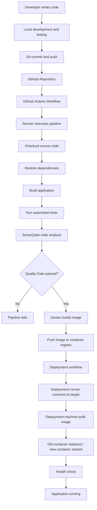
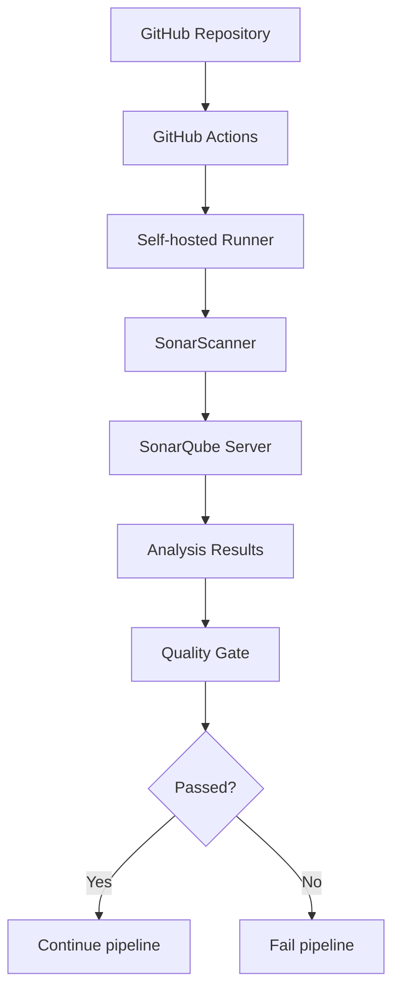
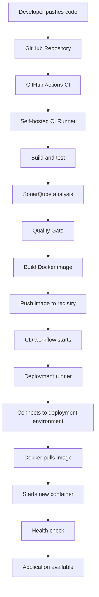
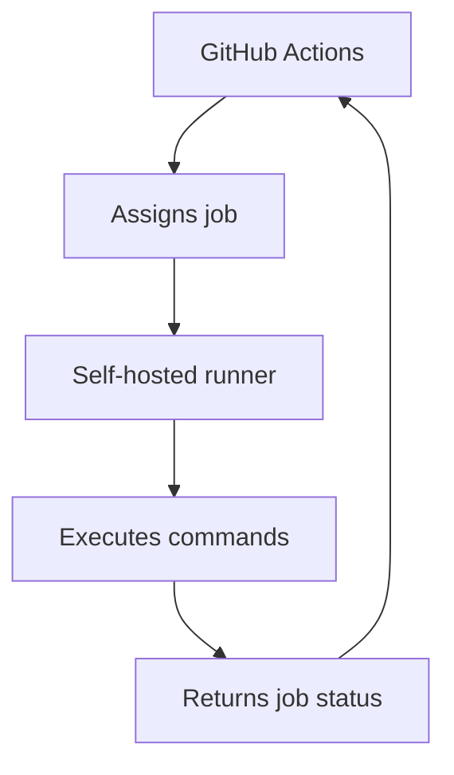

# Complete CI/CD Guide — From Developer Code to Production Deployment

## 1. First, understand the complete picture

Imagine a developer creates a new feature in an application.

For example, a developer adds a login API to a .NET application.

How does that code reach the production server?

The developer does not normally copy the source code manually to the production server. Instead, we automate the process using CI/CD.

### The complete CI/CD architecture



This is a typical container-based CI/CD architecture. Your company's actual pipeline may use different tools or deploy application files instead of Docker images.

---

# 2. What is CI/CD?

CI/CD is a process that automates building, testing, packaging, and deploying software.

CI/CD has two major parts:

- CI — Continuous Integration
- CD — Continuous Delivery or Continuous Deployment

## 2.1 Continuous Integration (CI)

CI means developers frequently integrate their code into a shared repository.

Whenever a developer pushes code to GitHub, an automated pipeline can start.

For example:

1. Developer writes code.
2. Developer commits the code.
3. Developer pushes code to GitHub.
4. GitHub Actions detects the push.
5. The pipeline builds the application.
6. Automated tests execute.
7. SonarQube analyses the code.
8. The pipeline reports success or failure.

The objective is to identify problems early, before the code is released.

**Example:**

A developer changes the login API and accidentally introduces a compilation error.

Without CI:
- The code gets pushed.
- Someone may discover the error much later.
- Other developers may also integrate broken code.

With CI:
- The pipeline automatically builds the application.
- The build fails.
- The team gets feedback immediately.

## 2.2 Continuous Delivery vs Continuous Deployment

CD can mean two different things.

**Continuous Delivery**

The application is automatically built, tested, and prepared for deployment. A person may need to approve the production deployment.

**Continuous Deployment**

Every qualifying change that passes the pipeline is automatically deployed to production without a manual release approval.

Example:

| Stage | Continuous Delivery | Continuous Deployment |
|---|---|---|
| Build | Automated | Automated |
| Test | Automated | Automated |
| Code analysis | Automated | Automated |
| Package | Automated | Automated |
| Production deployment | May require approval | Automated |

---

# 3. What is GitHub?

GitHub is a platform where developers store and collaborate on source code.

Think of GitHub as the central storage location for your project.

Example repository:

```text
MyApplication/
│
├── Controllers/
├── Services/
├── Repositories/
├── Models/
├── Tests/
├── Program.cs
├── appsettings.json
└── MyApplication.csproj
```

A developer works on this project locally and pushes changes to GitHub.

### Important Git commands

```bash
# Get the repository
git clone <repository-url>

# Check modified files
git status

# Stage changes
git add .

# Commit changes
git commit -m "Added login API"

# Push changes to GitHub
git push origin main
```

Git is the version control system.

GitHub is the platform hosting the Git repository.

---

# 4. What happens after the developer pushes code?

This is where GitHub Actions comes into the picture.

## 4.1 What is GitHub Actions?

GitHub Actions is an automation platform built into GitHub.

It listens for events and executes workflows.

For example:

- Developer pushes code.
- Pull request is created.
- A scheduled time is reached.
- Someone manually starts a workflow.

GitHub Actions can respond to these events and execute tasks.

Think of it this way:

- GitHub repository = stores your code.
- GitHub Actions = decides which automated tasks to execute.
- Runner = machine that actually executes those tasks.

GitHub Actions is the orchestrator. It does not itself compile your application on some magical computer.

## 4.2 What is a workflow?

A workflow is an automated process defined in a YAML file.

GitHub looks for workflow files inside:

```text
.github/
    workflows/
        ci.yml
        cd.yml
```

Example:

```yaml
name: My First CI Pipeline

on:
  push:
    branches:
      - main

jobs:
  build:
    runs-on: ubuntu-latest

    steps:
      - name: Checkout code
        uses: actions/checkout@v4

      - name: Display message
        run: echo "CI pipeline started"
```

Let's understand each part.

| YAML keyword | Meaning |
|---|---|
| `name` | Name of the workflow |
| `on` | Event that triggers the workflow |
| `push` | Trigger when code is pushed |
| `branches` | Branches to monitor |
| `jobs` | Tasks to execute |
| `runs-on` | Machine type / runner to use |
| `steps` | Individual operations |
| `uses` | Reuse an existing GitHub Action |
| `run` | Execute a shell command |

## 4.3 What is a GitHub Actions runner?

A runner is the machine that executes the workflow steps.

For example, consider:

```yaml
jobs:
  build:
    runs-on: ubuntu-latest

    steps:
      - name: Checkout code
        uses: actions/checkout@v4

      - name: Build application
        run: dotnet build
```

GitHub Actions receives the instruction:

"Execute this job on an Ubuntu runner."

The runner then:
1. Gets the source code.
2. Executes the commands.
3. Builds the application.
4. Reports the result to GitHub Actions.

There are two main runner types.

### A. GitHub-hosted runner

GitHub provides and manages the machine.

```yaml
runs-on: ubuntu-latest
```

GitHub provides a hosted environment with the required operating system and tools.

Advantages:
- No need to create a VM.
- No need to install the runner agent yourself.
- Easy to get started.
- GitHub manages the hosted machine.

### B. Self-hosted runner

Your organization provides and manages the machine.

It could be:
- A Windows VM.
- An Ubuntu VM.
- A physical server.
- A machine hosted in Azure or another cloud.
- An on-premises server.

You install GitHub's runner software on that machine and register it with your repository or organization.

Now GitHub Actions can send eligible jobs to that machine.

Example:

```yaml
jobs:
  build:
    runs-on: [self-hosted, linux, x64, dotnet]

    steps:
      - name: Checkout code
        uses: actions/checkout@v4

      - name: Build application
        run: dotnet build
```

The runner must have all the specified labels.

### Why do companies use self-hosted runners?

Suppose your company has:

- A private SonarQube server.
- A private database.
- Internal package repositories.
- Applications that can only be accessed through the company network.
- Specific software or SDK versions.

A GitHub-hosted runner might not have access to those internal resources.

Your company can create a VM inside its network and install a self-hosted runner on it.

Now the runner can access permitted internal resources.

**Important:** A self-hosted runner is not automatically required for every CI pipeline. It is used when the organization needs control over the machine, network access, tools, or execution environment.

---

# 5. What exactly happens inside a CI pipeline?

Let's take a .NET application.

The developer pushes code to GitHub.

GitHub Actions triggers a workflow, and the runner executes the following stages.

## Stage 1: Checkout

```yaml
- name: Checkout source code
  uses: actions/checkout@v4
```

What happens?

The runner downloads the repository's source code into its workspace.

For example:

```text
Runner VM
    |
    └── Workspace/
          └── MyApplication/
                ├── Controllers/
                ├── Services/
                ├── Program.cs
                └── MyApplication.csproj
```

The runner now has the source code it needs to work with.

## Stage 2: Restore dependencies

```yaml
- name: Restore dependencies
  run: dotnet restore
```

What happens?

A .NET application may depend on external packages.

For example:

- Entity Framework Core.
- Newtonsoft.Json.
- Serilog.
- Other NuGet packages.

`dotnet restore` downloads the required dependencies.

Think of it as downloading the libraries your application needs.

## Stage 3: Build

```yaml
- name: Build application
  run: dotnet build --configuration Release --no-restore
```

What happens?

The compiler converts the source code into compiled output.

If the code contains compilation errors, the build fails.

For example:

```csharp
public class UserService
{
    public string GetUser()
    {
        return "Hello User";
    }
}
```

The build process compiles the C# code into the output required by the .NET application.

## Stage 4: Run automated tests

```yaml
- name: Run tests
  run: dotnet test --configuration Release
```

What happens?

The pipeline executes automated tests.

Example:

```csharp
[Fact]
public void GetUser_ReturnsExpectedName()
{
    var service = new UserService();

    var result = service.GetUser();

    Assert.Equal("Hello User", result);
}
```

If a test fails, the pipeline can stop.

Why?

We do not want to release code that breaks existing functionality.

## Stage 5: SonarQube analysis

Now comes SonarQube.

---

# 6. What is SonarQube?

SonarQube is a code quality and security analysis platform.

Its job is to analyse your source code and identify potential problems.

It can detect:

- Bugs.
- Code smells.
- Security vulnerabilities.
- Security hotspots.
- Duplicated code.
- Maintainability problems.

It can also show test coverage when supported coverage reports are supplied.

### Example

Suppose a developer writes:

```csharp
public void ProcessPayment()
{
    string password = "Admin@123";

    Console.WriteLine(password);
}
```

There may be a security issue because a password is hardcoded.

SonarQube can identify certain hardcoded credentials and flag them for investigation.

Another example:

```csharp
public int Calculate(int a, int b)
{
    return a + b;
}
```

Imagine the same logic is copied across many files.

SonarQube can report duplicated code.

### 6.1 How does SonarQube connect to CI?

The pipeline runs a SonarQube scanner.

The scanner analyses the source code and sends the analysis results to the SonarQube server.

Architecture:



Important distinction:

- SonarScanner performs or collects the analysis.
- SonarQube server processes and displays the analysis.
- Quality Gate evaluates whether the configured quality conditions have passed.

### 6.2 What is a Quality Gate?

A Quality Gate is a set of conditions that code must satisfy.

For example, your company might configure rules such as:

- No new critical vulnerabilities.
- No new blocker bugs.
- Minimum test coverage on new code.
- Maximum allowed duplication on new code.

These are examples, not universal defaults.

If the Quality Gate fails, the CI pipeline can be configured to stop.

This prevents code that violates the team's quality requirements from progressing to deployment.

### 6.3 Does SonarQube build the application?

No.

SonarQube does not replace the compiler.

| Tool | Responsibility |
|---|---|
| .NET SDK/compiler | Builds the application |
| `dotnet test` | Executes automated tests |
| SonarScanner | Performs or collects code analysis |
| SonarQube | Processes and displays analysis |
| Quality Gate | Evaluates configured quality conditions |

SonarQube is a quality-checking stage, not a deployment tool.

---

# 7. What happens after CI succeeds?

Once the code has passed the required checks, we need to package it.

There are two common deployment approaches:

1. Publish application files.
2. Build a Docker image.

Let's understand Docker first.

# 8. What is Docker?

Docker is a platform used to package and run applications in containers.

Imagine your application needs:

- Application code.
- Runtime.
- Libraries.
- Configuration.
- Other dependencies.

If we install everything manually on every server, deployment becomes difficult.

Docker helps package the application and its required runtime components into an image.

## 8.1 Docker image

A Docker image is a packaged template used to create containers.

Example:

```text
MyApplication Docker Image
    |
    ├── Application files
    ├── .NET runtime
    ├── Required dependencies
    └── Startup instructions
```

An image is not the running application.

It is the package from which a container can be created.

## 8.2 Docker container

A container is a running instance of an image.

For example:

```bash
docker run -d -p 8080:8080 myapplication:1.0
```

This starts a container using the image.

Think of it like this:

- Docker image = packaged application.
- Docker container = running instance of that packaged application.

You can create multiple containers from the same image.

## 8.3 What is a Dockerfile?

A Dockerfile contains instructions for building a Docker image.

Example for an ASP.NET Core application:

```dockerfile
# Build stage
FROM mcr.microsoft.com/dotnet/sdk:8.0 AS build

WORKDIR /src

COPY . .

RUN dotnet restore

RUN dotnet publish -c Release -o /app/publish

# Runtime stage
FROM mcr.microsoft.com/dotnet/aspnet:8.0 AS runtime

WORKDIR /app

COPY --from=build /app/publish .

EXPOSE 8080

ENTRYPOINT ["dotnet", "MyApplication.dll"]
```

Note: This is an illustrative example for a compatible .NET 8 ASP.NET Core application. Your project may require a different SDK/runtime version and port configuration.

### What does this Dockerfile do?

| Instruction | Meaning |
|---|---|
| `FROM` | Selects a base image |
| `WORKDIR` | Sets the working directory |
| `COPY` | Copies files into the image |
| `RUN` | Executes commands while building the image |
| `EXPOSE` | Documents the container's listening port |
| `ENTRYPOINT` | Defines the startup command |

This example uses a multi-stage build.

First stage:
- Uses the .NET SDK.
- Restores dependencies.
- Compiles and publishes the application.

Second stage:
- Uses a smaller ASP.NET runtime image.
- Copies the published application.
- Starts the application.

The SDK is needed to build. The runtime is needed to run the published application.

---

# 9. What is a Container Registry?

After building a Docker image, where do we store it?

We store it in a container registry.

A registry is a place where Docker images are stored and distributed.

Examples:

- Docker Hub.
- Azure Container Registry (ACR).
- Amazon Elastic Container Registry (ECR).
- GitHub Container Registry (GHCR).

Think of a registry as a storage location for Docker images.

### Example

Our pipeline builds:

```text
myapplication:1.0
```

It pushes the image to a registry:

```text
mycompany.azurecr.io/myapplication:1.0
```

Now the image is available for an authorised deployment machine to download.

### Important difference

| Component | What it stores |
|---|---|
| GitHub repository | Source code |
| Container registry | Docker images |
| Artifact repository | Build artifacts/packages |
| Deployment machine | Running application/container |

A container registry is not the same as a Git repository.

---

# 10. What is an artifact?

An artifact is a build output that we preserve and pass to later pipeline stages.

For a .NET application, an artifact might be:

```text
publish/
    MyApplication.dll
    MyApplication.deps.json
    MyApplication.runtimeconfig.json
    appsettings.json
```

If we use Docker, the Docker image becomes the deployable package.

The important principle is:

**Build once, deploy the same tested output.**

We should avoid building one version for testing and independently rebuilding a potentially different version for production.

Artifacts can be stored in:
- GitHub Actions artifacts.
- JFrog Artifactory.
- Azure Artifacts.
- A container registry.
- Other approved artifact repositories.

---

# 11. What is the deployment machine?

Now we reach the deployment part.

A deployment machine is the server or VM where the application will actually run.

For example:

```text
Production VM
    |
    ├── Operating System
    ├── Docker Engine
    ├── Application container
    └── Application listening on a port
```

The deployment machine is different from a CI runner in many architectures.

### CI runner vs deployment machine

| CI runner | Deployment machine |
|---|---|
| Executes CI/CD jobs | Hosts the application |
| Checks out source code | Runs the deployed application |
| Builds and tests code | Runs the published output/container |
| May need .NET SDK | Needs the appropriate runtime or container engine |
| Reports job status to GitHub | Serves application requests |

They may be separate VMs.

Sometimes a separate deployment runner connects to the deployment machine and performs the deployment.

Sometimes the deployment runner and deployment target are the same machine.

The design depends on the company's infrastructure and security requirements.

---

# 12. How does the code actually reach the deployment machine?

Let's understand this carefully.

Assume we are using Docker.

The process looks like this:



Let's break it down.

## Step 1: Developer pushes code

```bash
git add .
git commit -m "Added login API"
git push origin main
```

GitHub receives the new code.

## Step 2: GitHub Actions starts CI

The workflow is triggered by the push event.

GitHub Actions assigns the job to an eligible runner.

## Step 3: Runner builds and tests

The runner:

1. Checks out code.
2. Restores NuGet packages.
3. Builds the application.
4. Runs tests.
5. Runs SonarQube analysis.

## Step 4: Docker builds an image

After the required checks pass:

```bash
docker build -t myapplication:1.0 .
```

This uses the Dockerfile to create an image.

## Step 5: Push the image to a registry

Example:

```bash
docker tag myapplication:1.0 myregistry.example.com/myapplication:1.0

docker push myregistry.example.com/myapplication:1.0
```

The image is now stored in the registry.

The registry could be ACR, GHCR, Docker Hub, or another company-approved service.

## Step 6: CD workflow starts

The CD workflow is responsible for deploying the tested image.

It can run after CI succeeds or be started through a manual approval/release process.

## Step 7: Deployment runner connects to the deployment machine

The deployment job executes deployment commands.

For example, it may:
- Connect to a target VM through an approved secure mechanism.
- Authenticate with the registry.
- Pull the required image.
- Replace the old container with the new one.
- Verify that the application is healthy.

The runner needs network access and appropriate permissions.

## Step 8: Deployment machine pulls the image

On the deployment machine:

```bash
docker pull myregistry.example.com/myapplication:1.0
```

Now the deployment machine has the image.

## Step 9: Start the new container

An illustrative command:

```bash
docker run -d \
  --name myapplication \
  -p 8080:8080 \
  myregistry.example.com/myapplication:1.0
```

The application is now running inside the container.

A real deployment must also handle configuration, secrets, persistent data, networking, old-container replacement, rollback, and health checks.

---

# 13. What is a CD pipeline?

A CD pipeline automates the deployment process.

An example:

```yaml
name: MyApplication-CD

on:
  workflow_dispatch:

jobs:
  deploy:
    runs-on: [self-hosted, linux, x64, deployment]

    steps:
      - name: Login to registry
        run: echo "Authenticate using approved registry credentials"

      - name: Pull Docker image
        run: docker pull myregistry.example.com/myapplication:1.0

      - name: Deploy application
        run: |
          docker stop myapplication || true
          docker rm myapplication || true
          docker run -d \
            --name myapplication \
            -p 8080:8080 \
            myregistry.example.com/myapplication:1.0
```

This is a simplified teaching example, not a production-ready deployment.

In production, avoid hardcoding credentials or relying on a mutable `1.0` tag alone. Use securely managed credentials, immutable image tags or digests, health checks, controlled replacement, and rollback.

---

# 14. What is the relationship between GitHub Actions and the self-hosted runner?

This is very important.

Imagine GitHub Actions is a manager.

The manager assigns a task.

The self-hosted runner is the worker that executes that task.



GitHub Actions does not need to install your application on the deployment VM itself.

It instructs a runner to execute the deployment process.

A runner is not the same thing as a deployment server.

---

# 15. Do we need two VMs or three VMs?

There is no universal answer. Let's understand a common architecture.

### Option A: Two VMs

```text
VM 1 — CI / Deployment Runner
    |
    ├── GitHub Actions runner
    ├── .NET SDK
    ├── Docker CLI
    └── Deployment tools

VM 2 — Application Server
    |
    ├── Docker Engine
    └── Application container
```

Here, one runner may execute both CI and deployment jobs.

### Option B: Three VMs

```text
VM 1 — CI Runner
    |
    └── Builds, tests, scans and packages code

VM 2 — Deployment Runner
    |
    └── Executes deployment operations

VM 3 — Application Server
    |
    └── Runs the application
```

This separates build execution, deployment permissions, and application hosting.

It can improve isolation and security.

### Which approach is better?

That depends on:
- Company security policies.
- Network architecture.
- Application hosting model.
- Number of environments.
- Deployment permissions.
- Infrastructure costs.

Do not assume that every company needs three VMs.

---

# 16. What happens if the application is NOT using Docker?

Docker is optional.

A .NET application can also be published as normal files and deployed directly to a server.

For example:

```bash
dotnet publish -c Release -o ./publish
```

This produces published application files.

The pipeline can upload those files as an artifact.

Then the CD process can copy the artifact to the deployment machine and restart the application.

### Example: Windows Server + IIS

```text
GitHub
  |
  v
GitHub Actions
  |
  v
Self-hosted runner
  |
  ├── Build
  ├── Test
  ├── SonarQube
  └── Publish
        |
        v
    Build artifact
        |
        v
    Deployment process
        |
        v
    Windows Server
        |
        v
    IIS
        |
        v
    .NET application
```

In this architecture:
- The CI runner builds the application.
- The artifact contains published files.
- The deployment process copies the files to the server.
- IIS hosts the application.

For ASP.NET Core on IIS, the server needs the appropriate .NET Hosting Bundle and IIS configuration.

If the application is classic .NET Framework, its build and hosting requirements are different.

**Therefore, confirm whether your application is .NET Framework or modern .NET / ASP.NET Core before deciding the exact deployment procedure.**

---

# 17. What are environments?

Applications are commonly deployed into multiple environments.

| Environment | Purpose |
|---|---|
| Development | Developers test changes |
| QA / Testing | QA team validates functionality |
| UAT | Business users validate the application |
| Staging | Production-like final verification |
| Production | Actual users access the application |

Example flow:

```text
Developer
   |
   v
GitHub
   |
   v
CI Pipeline
   |
   v
Development Environment
   |
   v
QA Environment
   |
   v
UAT Environment
   |
   v
Production Environment
```

A company may use fewer or more environments.

Each environment may have:
- A separate VM.
- A separate database.
- Different configuration.
- Different secrets.
- Different access permissions.

The same tested artifact should be promoted through environments wherever practical. Environment-specific configuration should be supplied securely at deployment/runtime rather than rebuilding different application binaries for each environment.

---

# 18. What are secrets and variables?

Your pipeline may need credentials and configuration values.

Examples:
- SonarQube token.
- SonarQube server URL.
- Container registry credentials.
- Deployment credentials.
- Database connection strings.

Never hardcode sensitive credentials in YAML files.

GitHub provides:
- Repository secrets.
- Organization secrets.
- Environment secrets.
- Variables for non-sensitive configuration.

Example:

```yaml
- name: Run analysis
  run: |
    echo "Connecting to SonarQube"
  env:
    SONAR_TOKEN: ${{ secrets.SONAR_TOKEN }}
    SONAR_HOST_URL: ${{ vars.SONAR_SERVER }}
```

The values must be configured in the appropriate GitHub settings.

A missing variable such as `SONAR_SERVER` is a configuration problem. Installing a self-hosted runner does not automatically create that variable.

---

# 19. What is the difference between Docker, GitHub Actions, SonarQube and GitHub?

These tools have different responsibilities.

| Technology | Responsibility |
|---|---|
| Git | Version control |
| GitHub | Stores source code |
| GitHub Actions | Orchestrates automated workflows |
| GitHub runner | Executes workflow jobs |
| Self-hosted runner | Company-managed workflow execution machine |
| .NET SDK | Builds .NET applications |
| Automated tests | Validate application behaviour |
| SonarQube | Analyses code quality and security |
| Docker | Builds and runs container images |
| Container registry | Stores Docker images |
| Artifact repository | Stores build artifacts |
| Deployment runner | Executes deployment tasks |
| Deployment VM | Hosts the running application |
| IIS / Nginx / Kestrel | Helps serve web applications, depending on architecture |

---

# 20. Example complete .NET CI workflow

This is a simplified example of a CI workflow for a .NET solution.

```yaml
name: DotNet-CI

on:
  push:
    branches:
      - main

  pull_request:
    branches:
      - main

jobs:
  build:
    runs-on: [self-hosted, linux, x64, dotnet]

    steps:
      - name: Checkout source code
        uses: actions/checkout@v4

      - name: Restore dependencies
        run: dotnet restore MyApplication.sln

      - name: Build application
        run: dotnet build MyApplication.sln --configuration Release --no-restore

      - name: Run tests
        run: dotnet test MyApplication.sln --configuration Release

      - name: Publish application
        run: dotnet publish src/MyApplication/MyApplication.csproj --configuration Release -o ./publish
```

Adjust the solution and project paths to your actual repository structure.

This example does not yet include SonarQube, Docker image creation, artifact storage, or deployment. Those are additional stages.

---

# 21. Common problems in CI/CD

| Problem | Possible reason |
|---|---|
| Runner offline | VM stopped, network issue, runner service stopped |
| Job waiting | No available online runner matching all labels |
| `dotnet` command not found | SDK not installed or not in PATH |
| Build failed | Compilation error or incorrect SDK/framework |
| Restore failed | NuGet/network/package source issue |
| SonarQube connection failed | Incorrect URL, credentials, DNS or network issue |
| Quality Gate failed | Code did not meet configured conditions |
| Docker build failed | Dockerfile or build context issue |
| Docker push failed | Registry authentication or permission issue |
| Deployment failed | Target unreachable, permission issue, configuration problem |
| Application not responding | Port, runtime, configuration or application error |

---

# 22. Security considerations

Self-hosted runners are powerful because they can access your company's internal systems.

That also makes them sensitive infrastructure.

Important rules:

1. Use dedicated machines for runners where practical.
2. Restrict which repositories and workflows can use them.
3. Do not expose production credentials to untrusted pull requests.
4. Use least-privilege accounts.
5. Store secrets in approved secret-management systems.
6. Keep the OS and runner software updated.
7. Clean up workspaces and temporary credentials.
8. Restrict network access to only what is required.
9. Separate production deployment permissions from ordinary CI permissions.
10. Use approval gates for sensitive production deployments.

A self-hosted runner should not be treated as an ordinary developer laptop.

---

# 23. What YOU are doing in your company project

Let's connect everything to your current work.

Your team is migrating a Lucee application to .NET.

The developers write and push the .NET code to the company's GitHub repository.

The team is building the CI pipeline.

Your senior has asked you to work on self-hosted runners and the CD environment VM.

This is how those tasks fit into the bigger picture.

### Task 1: Self-hosted runner setup

You are preparing a company-managed machine so GitHub Actions can execute pipeline jobs inside your company's infrastructure.

Typical responsibilities:

- Get the VM and OS details.
- Confirm network connectivity to GitHub.
- Install the required tools.
- Register the runner with GitHub.
- Configure runner labels.
- Install and start the runner service.
- Confirm that GitHub shows it as Online and Idle.
- Test it using a simple workflow.

### Task 2: CD environment VM setup

You are preparing the machine or environment where the application will eventually run.

Depending on the architecture, this could involve:

- Operating system configuration.
- Docker Engine or IIS.
- .NET runtime / Hosting Bundle.
- Deployment directories.
- Network and firewall rules.
- Application configuration.
- Service accounts and permissions.
- Database connectivity.
- Health-check access.

Do not install everything before confirming the company's hosting architecture.

### Task 3: Connecting CI and CD

Once CI is working:

1. Code is checked out.
2. Dependencies are restored.
3. Application is built.
4. Tests execute.
5. SonarQube analysis runs.
6. Quality Gate is checked.
7. Application is published or packaged into Docker.
8. Artifact or image is stored.
9. CD workflow obtains the tested output.
10. Deployment process sends it to the target environment.
11. Application starts.
12. Health checks verify the deployment.

That is the complete journey.

---

# 24. Your learning roadmap

Learn these topics in this order.

- [ ] 1. Git and GitHub
- [ ] 2. CI/CD fundamentals
- [ ] 3. GitHub Actions architecture
- [ ] 4. Workflows, jobs, steps and triggers
- [ ] 5. GitHub-hosted vs self-hosted runners
- [ ] 6. Self-hosted runner installation
- [ ] 7. Linux and Windows server fundamentals
- [ ] 8. .NET restore, build, test and publish
- [ ] 9. SonarQube and Quality Gates
- [ ] 10. Docker images and containers
- [ ] 11. Dockerfiles and multi-stage builds
- [ ] 12. Container registries
- [ ] 13. Artifacts and artifact repositories
- [ ] 14. CD workflows
- [ ] 15. Deployment VM configuration
- [ ] 16. IIS / Kestrel / Docker hosting
- [ ] 17. Environment variables and secrets
- [ ] 18. Deployment verification and rollback
- [ ] 19. Monitoring and logs
- [ ] 20. CI/CD security and production best practices

---

# 25. Final revision: Remember this architecture

```text
DEVELOPER
    |
    | Writes code
    v
GIT
    |
    | Commit and push
    v
GITHUB REPOSITORY
    |
    | Push event
    v
GITHUB ACTIONS
    |
    | Assigns workflow job
    v
SELF-HOSTED RUNNER
    |
    | Checkout
    | Restore
    | Build
    | Test
    | SonarQube
    | Quality Gate
    v
PACKAGE APPLICATION
    |
    | Docker image OR published files
    v
REGISTRY / ARTIFACT REPOSITORY
    |
    | CD retrieves tested output
    v
DEPLOYMENT RUNNER
    |
    | Executes deployment
    v
DEPLOYMENT MACHINE
    |
    | Runs container OR hosts published files
    v
APPLICATION AVAILABLE TO USERS
```

**One-line definitions to remember:**

- Git: Tracks changes in source code.
- GitHub: Hosts the Git repository.
- GitHub Actions: Automates the CI/CD workflow.
- Runner: Machine that executes workflow jobs.
- Self-hosted runner: A runner installed and managed on your organization's infrastructure.
- SonarQube: Analyses code quality and security.
- Quality Gate: Decides whether configured quality conditions have passed.
- Docker: Packages and runs applications in containers.
- Docker image: Package/template used to create a container.
- Docker container: Running instance of an image.
- Registry: Stores and distributes Docker images.
- Artifact: Output produced by a build.
- CD: Delivers or deploys the tested application.
- Deployment VM: Machine that hosts the running application.

**The most important distinction: GitHub Actions tells the runner what to do; the runner executes the commands; the deployment machine runs the application.**
